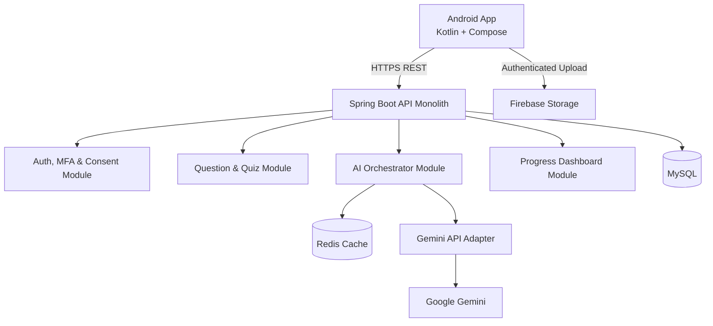

# System Architecture v1.1

## 1. Architecture Diagram

## 2. Data Flow (Image Question)
1. App gets upload authorization/token.
2. App uploads image directly to Firebase Storage.
3. App sends `/api/v1/questions` request with the Firebase object path.
4. Backend verifies ownership, fetches image bytes, and calls Gemini via adapter.
