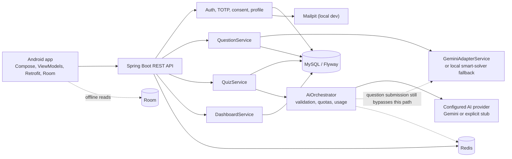

# AI Study Mentor

AI Study Mentor is an Android-first study app with a Spring Boot API. This README describes the current implementation in the P19 worktree; the feature table distinguishes source/test evidence from a live demo.

## Architecture



The dev backend uses MySQL, Redis, and Mailpit through Docker Compose. Production configuration targets PostgreSQL, but its Flyway migration set is incomplete and is not production-verified. Image-storage classes, report tables, and AI-orchestration components exist, but their complete end-to-end flows are not wired into the current Android/API paths.

## Feature status

| Area | Current implementation | P19 acceptance status |
|---|---|---|
| Registration, MFA, profile/onboarding, guardian consent | Backend routes and Android auth/profile screens exist; backend tests cover core flows | Automated coverage exists; live P19 flow not verified |
| Text questions | Question persistence and Gemini adapter call exist; absent Gemini configuration falls back to a deterministic local answer | Not accepted as a real-AI demo; P19 live flow not verified |
| AI cache/quota | Cache, quota, and orchestration components exist | Active `QuestionService` bypasses `AiOrchestrator`; cache hit/quota enforcement not verified on question submission |
| Photo questions | Upload metadata/service components exist | No complete upload-byte → question → Gemini flow in the active controller and Android client |
| History and bookmarks | Room-backed screens; recent/history/bookmark items open saved-question details with bookmark controls; backend POST adds and DELETE removes idempotently | Offline live journey and remote search not verified |
| Quizzes | `QuizService` delegates generation to `AiOrchestrator`; validated content and server-side scoring; Android supports pre-attempt subject edit/delete | Mocked-provider integration and focused emulator tests pass; live Gemini quality and full P19 quiz journey remain unverified |
| Progress | Dashboard screen and basic question/quiz aggregates exist | No time-window analytics; live P19 verification not performed |
| Account deletion | Reauthenticated backend deletion job and Android privacy flow exist | Automated evidence exists; live P19 deletion not verified |
| Notifications | Profile reminder switches persist preferences and trigger WorkManager scheduling | Local delivery and FCM are not verified in a live P19 flow |
| Answer reporting | Database migration/entity exists | No report controller or Android API/UI route |

See [the API specification](../docs/API_SPEC.md), [known limitations](../docs/KNOWN_LIMITATIONS.md), and [P19 acceptance checklist](../docs/evidence/final/ACCEPTANCE_CHECKLIST.md) for details and evidence.

## Local run

Use Temurin JDK 17.0.21, Docker Compose v2, Android SDK 34+, and a booted `emulator-5554`. Configure the real Gemini key only in the ignored `backend/.env`; never print or commit it.

```powershell
.\scripts\demo-up.ps1
```

```bash
bash ./scripts/demo-up.sh
```

The script starts local dependencies, launches the dev backend (which runs Flyway and the dev seeder), builds and installs the debug APK, and prints local demo endpoints/credentials after readiness. Mailpit is available at `http://127.0.0.1:8025`. Detailed manual setup and credentials are in [RUN_LOCAL.md](../docs/RUN_LOCAL.md). P19 reached backend readiness and installed/launched the APK, but did not complete the full user journey; see the acceptance checklist.

## Test commands

Run backend verification with JDK 17 and Docker:

```powershell
$env:JAVA_HOME = "C:\Path\To\Temurin\jdk-17.0.21"
$env:PATH = "$env:JAVA_HOME\bin;$env:PATH"
Push-Location backend
.\mvnw.cmd --batch-mode --no-transfer-progress verify
Pop-Location
```

Run Android unit tests and lint:

```powershell
$env:JAVA_HOME = "C:\Path\To\Temurin\jdk-17.0.21"
$env:PATH = "$env:JAVA_HOME\bin;$env:PATH"
Push-Location android
.\gradlew.bat --no-daemon "-Pkotlin.compiler.execution.strategy=in-process" :app:testDebugUnitTest :app:lintDebug
Pop-Location
```

Connected emulator tests are local-only:

```powershell
Push-Location android
.\gradlew.bat --no-daemon "-Pkotlin.compiler.execution.strategy=in-process" :app:connectedDebugAndroidTest
Pop-Location
```
